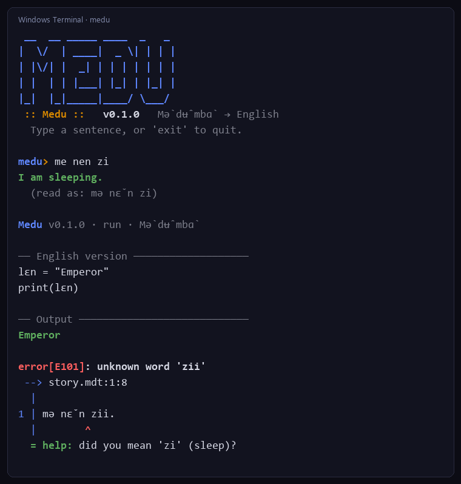
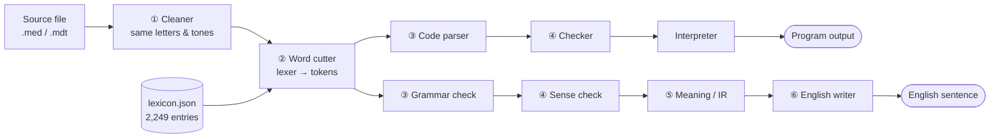

# Medu

**A compiler for Medumba** (Mə̀dʉ̂mbɑ̀, the language of Bangangté, Cameroon).
Medu reads Medumba, checks it for syntax errors, and translates it into English.
It will later become a **dual compiler** that also understands Bafut.

Compiler Construction course project · **CharlseEmpire Tech**
Authors: **Charllson** (lead architect) and **Adrien Tello** (second lead developer)

> Status: Mode 2 (sentences → English) works; Mode 1 (programs) in progress. Try it: `python -m medu.mode2`
> (examples in [samples/](samples/)). Build the Windows installer: [packaging/](packaging/README.md).

## How it will work

You write Medumba in a text file and run `medu`, the same way you run `python`.



```text
# story.mdt
mə nɛ̌n zi.

> medu translate story.mdt
I am sleeping.

> medu                 # interactive prompt
medu> me nen zi        # plain keyboard letters work too
I am sleeping.
```

| Command | What it does |
|---|---|
| `medu run file.med` | Checks a Medumba **program**, shows its English version and runs it |
| `medu translate file.mdt` | Translates Medumba **sentences** into English |
| `medu check file` | Only reports errors |
| `medu fmt file` | Rewrites the file in correct Medumba spelling |
| `medu learn` | Adds a missing word to the dictionary |

## Architecture

Six stations, one job each. Stations ① and ② are shared by both modes; every station can report an error with line, column and a "did you mean…?" hint.



| Station | Job | Catches |
|---|---|---|
| ① Cleaner | One standard spelling (Greek α → ɑ, apostrophes → ʼ, shortcuts like `e*` → ə) | Characters Medumba doesn't use |
| ② Word cutter (lexer) | Splits text into words and labels each from the dictionary | Unknown words |
| ③ Parser | Checks word order against grammar rules, builds a tree | Syntax errors |
| ④ Checker | Rules that need meaning (one tense, verb has its object) | Sentences that make no sense |
| ⑤ Meaning (IR) | Writes the meaning in no particular language | |
| ⑥ English writer | Says that meaning in correct English | |

Because ⑤ is language-free, adding **Bafut** only needs a new ①–④ and a Bafut dictionary; ⑤ and ⑥ are reused, and Medumba ↔ Bafut translation becomes possible.

The full illustrated architecture (diagrams, a sentence traced through every station, hard cases, the dual-compiler proposal) is in [`docs/architecture.html`](docs/architecture.html). Download it and open it in a browser.

## The dictionary

```bash
python tools/build_lexicon.py            # builds data/ from open sources (Python 3.10+, no packages)
python tools/build_lexicon.py --refresh  # downloads the sources again
```

- `data/languages/medumba/lexicon.json`: what the compiler loads
- `data/languages/medumba/lexicon.csv`: open in Excel or Google Sheets to review words
- `data/languages/medumba/SOURCES.md`: sources, licences and spelling rules

Words come from the open [Apertium](https://github.com/apertium/apertium-byv) Medumba data (GPL-3.0), with English meanings suggested from French via FreeDict. Meanings marked as auto-suggested still need a Medumba speaker's review.

## Project layout

```text
medu/
  medu/                    the compiler, one file per station (see each file's header)
  data/languages/medumba/  dictionary + Mode 1 keywords
  data/languages/bafut/    empty until the dual compiler
  tests/                   unit tests + examples/ (test files)
  tools/                   build_lexicon.py, run_examples.py
  docs/                    architecture page, team plan (PDF)
```

Team setup, file owners and branches: [CONTRIBUTING.md](CONTRIBUTING.md).

## Licence

GPL-3.0, because the dictionary data comes from GPL-3.0 sources. See [LICENSE](LICENSE).
